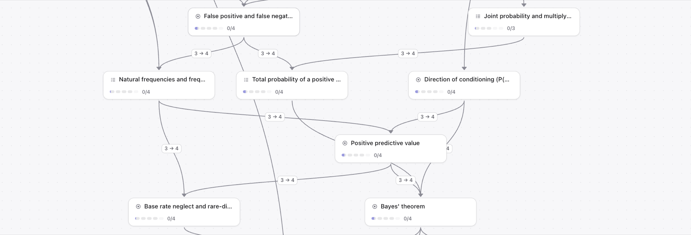
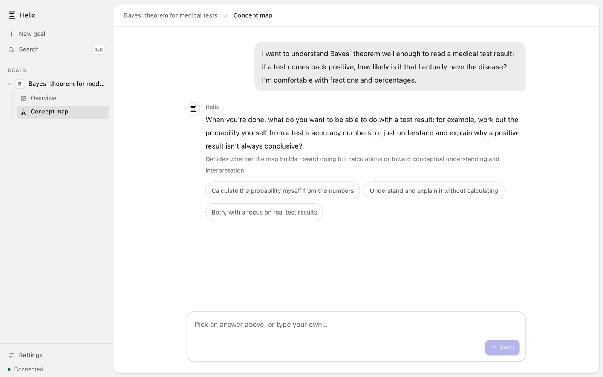
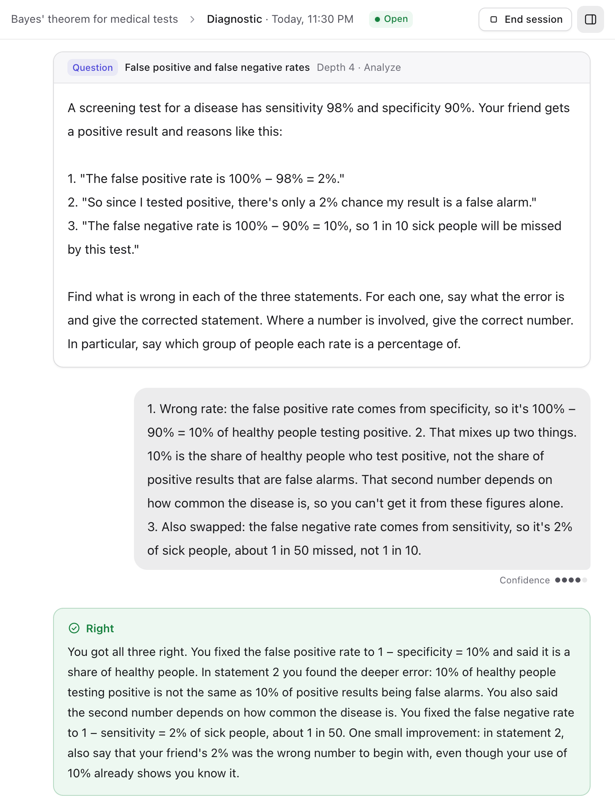
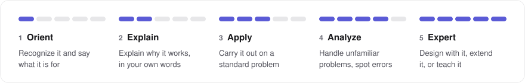

  <picture>
    <source media="(prefers-color-scheme: dark)" srcset="apps/web/public/brand/helix-mark-on-dark.svg">
    
  </picture>

<h1 align="center">Helix</h1>

  <b>Learn anything, to the depth you need.</b> 
  A personal AI tutor that maps what there is to learn, finds what you already know,
  and teaches you the rest, one step at a time. A desktop app for Mac, Windows, and Linux
  that works with the AI plan or API key you already have.

  
  
  
  

  

## How it works

### 1. Tell it what you want to learn

Describe your goal in a sentence: a course you're taking, an exam, a job, a project. Attach a
syllabus, notes, or a textbook chapter if you have them. Helix asks a few quick questions to pin
down the scope, then builds a **concept map**: every idea you need, how deep you need it, and
which ideas build on which.

  

The map is yours to edit: add, rename, connect, or remove concepts, and undo your own edits.

### 2. Find out where you stand

A diagnostic asks one question at a time, grades each answer with an explanation, and fills in
the map as it goes. Say "I don't know" whenever you don't; that's useful too. Stop whenever
you like, or keep going until the map is settled.

  

### 3. Learn the next thing

A tutoring session usually starts with a quick review of something you learned earlier, then
teaches the next concept you're ready for. Helix asks you to predict before it explains, gives
hints before answers, and checks your understanding at the end. Everything you answer updates
your map, so the next session picks up where this one left off.

## Five depths of knowing

Knowing what something is differs from being able to use it. Helix tracks each concept on a
five-step scale:

  <picture>
    <source media="(prefers-color-scheme: dark)" srcset=".github/assets/depths-dark.svg">
    
  </picture>

Each concept on your map gets a target depth for your goal. Helix measures where you stand and
teaches toward it. On the map, an arrow labeled `3 → 4` means you need the concept it starts from
at depth 3 before the one it points to at depth 4.

## Get started

1. **Download and install** Helix for your computer:
   [Mac, Apple silicon (M1 or later)](https://github.com/chaotyc/Helix/releases/latest/download/Helix-arm64.dmg) ·
   [Mac, Intel](https://github.com/chaotyc/Helix/releases/latest/download/Helix-x64.dmg) ·
   [Windows](https://github.com/chaotyc/Helix/releases/latest/download/Helix-Setup-x64.exe) ·
   [Linux AppImage](https://github.com/chaotyc/Helix/releases/latest/download/Helix-x86_64.AppImage) ·
   [Linux .deb (Debian, Ubuntu)](https://github.com/chaotyc/Helix/releases/latest/download/Helix-amd64.deb).
   On Linux, the AppImage needs FUSE 2 and `chmod +x`; on Debian or Ubuntu, the .deb is simpler.
2. **Connect a model.** Use a plan you already pay for, such as Claude, ChatGPT, or Google AI,
   through its command-line tool (Claude Code, Codex, Antigravity, and others), installed and
   signed in once. Or add an API key from Anthropic, OpenAI, Google, xAI, or Meta in **Settings**.
   On first launch, Helix finds what's set up on your computer and uses it for every job in one
   click.
3. **Create a goal** and start learning.

Helix checks for new versions when it opens and links you to the download.

---

  <a href="https://github.com/chaotyc/Helix/issues">Report a problem</a> ·
  <a href="LICENSE">MIT License</a>

